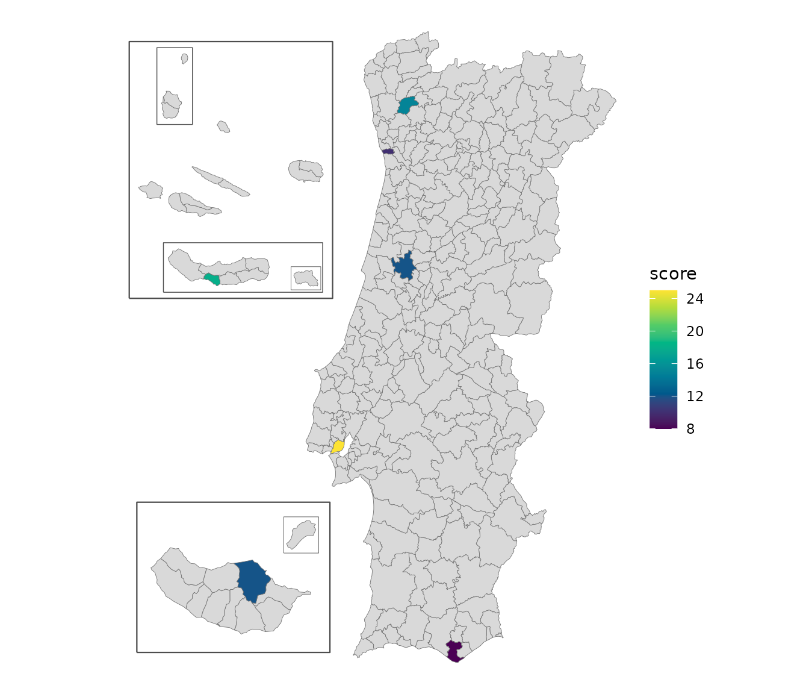

# Get started with geopt

geopt provides maps of Portugal that are ready to plot, with the Açores
and Madeira included, and the tools to put custom data on them. It also
keeps track of how the boundaries have changed over the years, and
downloads the full-resolution official data when needed.

This page is a short tour. Each section points to the guide that covers
its topic in full.

``` r

library(geopt)
```

## Portugal’s units in brief

geopt can draw any of these levels. The `level` value is what its
functions expect:

| `level` | What it is | Units |
|----|----|----|
| `"freguesia"` | Civil parish, the smallest administrative unit. | 3 259 |
| `"municipio"` | Municipality (município, also called concelho). LAU units | 308 |
| `"distrito"` | District on the mainland. Each island in Açores and Madeira | 29 |
| `"nuts1"`, `"nuts2"`, `"nuts3"` | The EU’s statistical regions (NUTS) | 3, 9, 26 |
| `"uls"` | Local health units (Unidades Locais de Saúde) and their island equivalents | 55 |
| `"reg_saude"` | Health regions (regiões de saúde) | 7 |
| `"aces"` | Groups of primary-care centres (ACES), the health units before 2024 | 71 |
| `"uls_municipio"`, `"aces_municipio"` | ULS and ACES for data by municipality: those that share a municipality are combined | 50, 66 |

Freguesias and municipalities also have official codes. A freguesia’s
code (DTMNFR) has six digits: the first four are its municipality’s code
(DTMN), and the first two are its district’s (DT). These are the names
DGT and INE use today. Older datasets may call them DICOFRE and DICO.
For example, Gualtar, `"030319"`, is a freguesia of Braga municipality
(`"0303"`), in Braga district (`"03"`).

## A map in one line

``` r

df <- data.frame(
  concelho = c("Porto","Lisboa","Braga","Coimbra","Faro","Lagoa (Açores)","Santana (RAM)"),
  score = c(10, 25, 15, 12, 8, 18, 12)
)

plot_pt(df, value = "score", by = c(municipio = "concelho"))
#> get_map: 301 boundaries have no data row (NA fill).
```



`by = c(municipio = "concelho")` tells geopt that the `concelho` column
holds municipality names. geopt matched each name to its municipality,
ignoring accents and case, and picked the right Lagoa: there are two,
one in the Algarve and one in the Açores. The islands are moved next to
the mainland so the map stays readable. For the mainland alone, add
`islands = "none"`.

The result is a regular ggplot that can be styled using native `ggplot`
grammar. For an interactive map, add `renderer = "echarts"`:

``` r

plot_pt(df, value = "score", by = c(municipio = "concelho"),
        renderer = "echarts")
#> get_map: 301 boundaries have no data row (NA fill).
```

## Check what matched

When every name is found, matching happens quietly. When some aren’t,
geopt says so instead of guessing:

``` r

df <- data.frame(
  concelho = c("Porto", "Lagoa", "Lisbon"),
  score    = c(10, 18, 25)
)

joined <- pt_join(df, by = c(municipio = "concelho"))
#> Warning: pt_match: 1 ambiguous name(s) returned NA. Pass `context` or use codes.
#>   'Lagoa' (2 candidates: Faro, Ilha de São Miguel)
#> Warning: pt_match: 1 unmatched name(s): Lisbon
#> pt_join: 1/3 row(s) matched at municipio level.
```

[`pt_join()`](https://c-matos.github.io/geopt/reference/pt_join.md) adds
the official codes to the data frame.
[`pt_match_report()`](https://c-matos.github.io/geopt/reference/pt_match_report.md)
then shows what happened to each name:

``` r

pt_match_report(joined)
#>    input matched_name code    method dist
#> 1  Porto        Porto 1312     exact   NA
#> 2  Lagoa         <NA> <NA> ambiguous   NA
#> 3 Lisbon         <NA> <NA> unmatched   NA
```

Two municipalities are called Lagoa, so geopt leaves it unmatched, with
the method “ambiguous” rather than pick one. “Lisbon” is an unknown name
to geopt, therefore the method shows “unmatched”. To solve each of
these, specify which Lagoa is meant by providing context - adding
“(Açores)” or “(RAA)” to the name - and map the unknown name with
`aliases`:

``` r

df$concelho[2] <- "Lagoa (Açores)"

joined <- pt_join(df, by = c(municipio = "concelho"),
                  aliases = c(Lisbon = "Lisboa"))
#> pt_join: 3/3 row(s) matched at municipio level.
joined[, c("concelho", "dtmn", "municipio", "nuts3", "reg_saude")]
#>         concelho dtmn municipio                       nuts3 reg_saude
#> 1          Porto 1312     Porto Área Metropolitana do Porto     Norte
#> 2 Lagoa (Açores) 4201     Lagoa  Região Autónoma dos Açores    Açores
#> 3         Lisbon 1106    Lisboa               Grande Lisboa       LVT
```

Besides the code,
[`pt_join()`](https://c-matos.github.io/geopt/reference/pt_join.md) adds
the regions each unit belongs to, which is useful even when no map is
drawn.
[`plot_pt()`](https://c-matos.github.io/geopt/reference/plot_pt.md) and
[`get_map()`](https://c-matos.github.io/geopt/reference/get_map.md)
match names the same way, and warn the same way.

[`vignette("joining-data")`](https://c-matos.github.io/geopt/articles/joining-data.md)
covers joining by code, freguesia names, names from older data, and
fuzzy matching for typos.

## Maps as sf objects

[`plot_pt()`](https://c-matos.github.io/geopt/reference/plot_pt.md) is a
shortcut. For more control over the plotting,
[`get_map()`](https://c-matos.github.io/geopt/reference/get_map.md)
returns the same map as an sf object, which works with ggplot2, tmap or
any other spatial package:

``` r

m <- get_map("nuts3")
head(m[, c("nuts3_cod", "nuts3", "area_ha")])
#> Simple feature collection with 6 features and 3 fields
#> Geometry type: MULTIPOLYGON
#> Dimension:     XY
#> Bounding box:  xmin: -8.881058 ymin: 40.75888 xmax: -7.171606 ymax: 42.1482
#> Geodetic CRS:  WGS 84
#>   nuts3_cod                       nuts3  area_ha                       geometry
#> 1     PT111                  Alto Minho 221884.2 MULTIPOLYGON (((-8.519346 4...
#> 2     PT112                      Cávado 124579.1 MULTIPOLYGON (((-8.792077 4...
#> 3     PT119                         Ave 145136.5 MULTIPOLYGON (((-8.440636 4...
#> 4     PT11A Área Metropolitana do Porto 204126.9 MULTIPOLYGON (((-8.789006 4...
#> 5     PT11B       Alto Tâmega e Barroso 292190.8 MULTIPOLYGON (((-7.325235 4...
#> 6     PT11C              Tâmega e Sousa 183151.5 MULTIPOLYGON (((-8.379446 4...
```

Besides one row per region, the result has a few extra rows for the
frames drawn around the islands, marked in the `geopt_type` column.

[`get_map()`](https://c-matos.github.io/geopt/reference/get_map.md) can
also join data, with the same `data` and `by` arguments as
[`plot_pt()`](https://c-matos.github.io/geopt/reference/plot_pt.md).

For boundaries in their true positions, without frames, use
`islands = "in_place"`, or the bundled datasets: `pt_freguesias`,
`pt_municipios`, `pt_distritos`, `pt_nuts1`, `pt_nuts2`, `pt_nuts3`,
`pt_uls`, `pt_reg_saude`, `pt_aces`, `pt_uls_municipio` and
`pt_aces_municipio`.

[`vignette("map-compositions")`](https://c-matos.github.io/geopt/articles/map-compositions.md)
shows how to change the island layout and the frames and how to map a
single region, such as the Açores, with examples for ggplot2, tmap,
echarts4r and plotly.

## Boundaries change over time

Portugal’s boundaries are redrawn from time to time, and data collected
before a change uses the old units. geopt calls each version of a set of
boundaries a *vintage*. Three things change, each on its own schedule,
so each has its own argument:

| What changes | Argument | Vintages |
|----|----|----|
| Freguesias | `admin_vintage` | `"2001"` and `"2011"` (the 2001 and 2011 censuses), `"2013"`, `"2025"` (current) |
| NUTS regions | `nuts_vintage` | `"2002"`, `"2013"`, `"2024"` (current) |
| Health regions | `health_vintage` | `"2022"` (before the 2024 reform), `"2024"` (current) |

Each `*_vintage` argument is optional: left out, it means the current
vintage.

Municipalities haven’t changed since 1998, so they’re the same in every
vintage.

[`pt_lookup()`](https://c-matos.github.io/geopt/reference/pt_lookup.md)
returns a table of units and the regions they belong to, for the
requested vintages. The NUTS regions were revised in 2024. Lisboa and
Setúbal are now in different NUTS 2 regions, but until then they shared
one:

``` r

now <- pt_lookup("municipio")
now[now$municipio %in% c("Lisboa", "Setúbal"), c("municipio", "nuts2_cod", "nuts2")]
#>     municipio nuts2_cod                nuts2
#> 153    Lisboa      PT1A        Grande Lisboa
#> 229   Setúbal      PT1B Península de Setúbal

before <- pt_lookup("municipio", nuts_vintage = "2013")
before[before$municipio %in% c("Lisboa", "Setúbal"), c("municipio", "nuts2_cod", "nuts2")]
#>     municipio nuts2_cod                        nuts2
#> 153    Lisboa      PT17 Área Metropolitana de Lisboa
#> 229   Setúbal      PT17 Área Metropolitana de Lisboa
```

A statistical series published before 2024 uses `PT17`, a code that no
longer exists.

Names from before a reorganization still match. In 2013, Braga’s
freguesia of Sé was merged with two others. geopt finds the freguesia
that covers it today, and marks the match as `historic`:

``` r

pt_match("Sé", level = "freguesia", context = "Braga")
#> [1] "030364"
#> attr(,"report")
#>   input matched_name   code   method dist
#> 1    Sé   Braga (Sé) 030364 historic   NA
```

`context = "Braga"` says which municipality to look in, since several
cities have a freguesia called Sé.

[`vignette("vintages")`](https://c-matos.github.io/geopt/articles/vintages.md)
covers converting data between vintages, maps of older years, and NUTS
revisions.

## Downloading official data

The bundled boundaries are simplified so they plot quickly. geopt can
also download official data: census data from INE, the statistics
institute, down to the level of city blocks, and the full-resolution
official boundaries (CAOP) from DGT, the mapping agency. Downloads are
cached, so each file is only fetched once.

``` r

# 2021 census data for Braga's statistical sections, with their boundaries
braga <- get_censos("Braga", level = "seccao")

# Full-resolution municipality boundaries for the mainland
client <- GeoClient$new()
mun <- client$get_caop("continente", "municipio")
```

`pt_censos_vars` lists the census variables available for each year and
level.
[`vignette("downloading-data")`](https://c-matos.github.io/geopt/articles/downloading-data.md)
covers the rest, including filtered queries to DGT’s online service.

## Where to go next

- **Change the island layout**, draw frames around the islands, or use
  tmap or echarts4r instead of ggplot2:
  [`vignette("map-compositions")`](https://c-matos.github.io/geopt/articles/map-compositions.md)
- **Get data onto the map** by code or by name, including ambiguous and
  misspelled names:
  [`vignette("joining-data")`](https://c-matos.github.io/geopt/articles/joining-data.md)
- **Map ULS, regiões de saúde or ACES**:
  [`vignette("health-geographies")`](https://c-matos.github.io/geopt/articles/health-geographies.md)
- **Work with older boundaries**, or convert freguesia data across
  reorganizations:
  [`vignette("vintages")`](https://c-matos.github.io/geopt/articles/vintages.md)
- **Download full-resolution CAOP**, INE census data, or query DGT’s
  online service:
  [`vignette("downloading-data")`](https://c-matos.github.io/geopt/articles/downloading-data.md)
