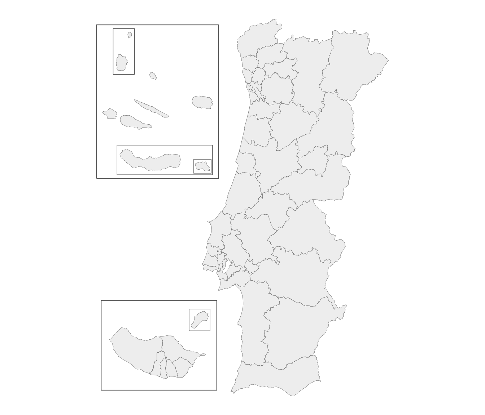
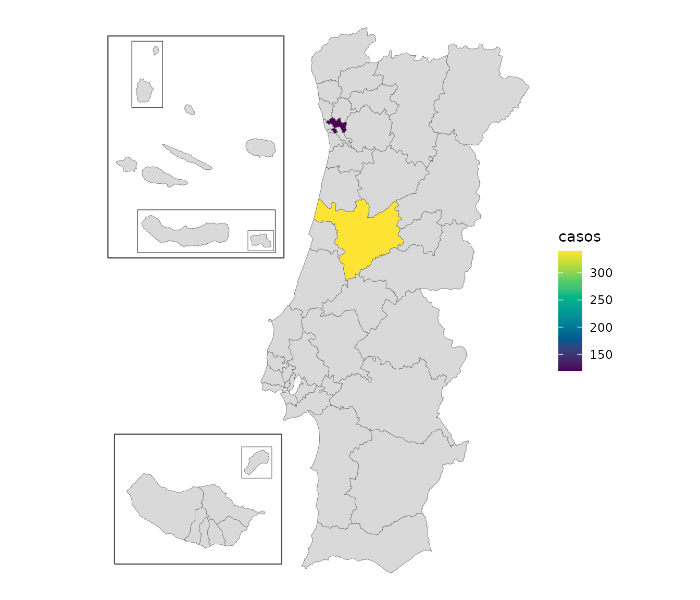
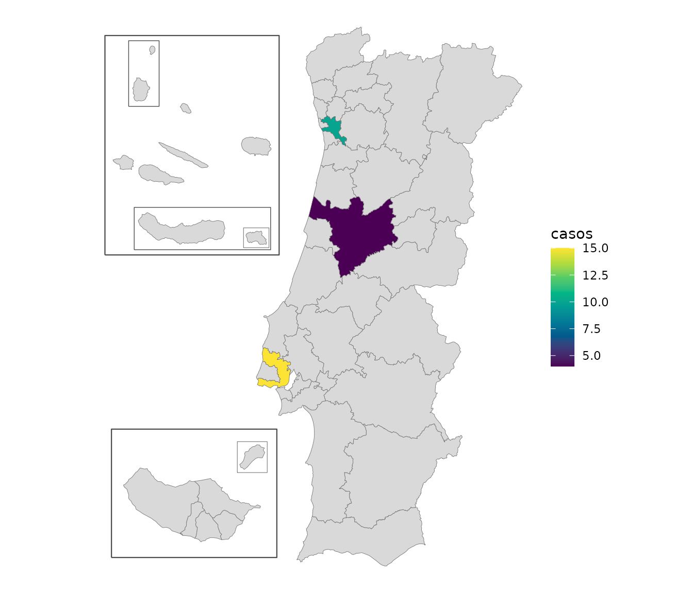

# Health geographies

``` r

library(geopt)
```

Besides the administrative levels, geopt includes three health
geographies. They’re built from the same freguesia boundaries as
everything else, so their borders line up exactly with municipalities
and NUTS regions.

- **`uls`**: the 39 Unidades Locais de Saúde (local health units)
  created by the 2024 reform of the national health service (SNS), plus
  their equivalents in the islands, which aren’t called ULS: nine
  Unidades de Saúde de Ilha in the Açores (“USI São Miguel”, …) and
  seven centros de saúde in Madeira (“CS Funchal Zona I”, …). 55 units
  in total.
- **`reg_saude`**: the 7 health regions (regiões de saúde), with their
  2024 boundaries.
- **`aces`**: the 71 Agrupamentos de Centros de Saúde (groups of
  primary-care centres) that the ULS replaced in 2024. Seven of the 71
  are ULS that already existed before the reform and took the place of
  ACES in their area: Guarda, Matosinhos, Alto Minho, Nordeste, Baixo
  Alentejo, Litoral Alentejano and Norte Alentejano. ULS de Castelo
  Branco, which also existed, appears through its two ACES.

They work wherever a level is accepted:

``` r

plot_pt(level = "uls")
```



## Joining health data

Join by unit name. Names are matched the same way as everywhere else,
ignoring case and accents:

``` r

df <- data.frame(uls = c("ULS Coimbra", "uls são joão"), casos = c(340, 120))
m <- get_map("uls", data = df, by = "uls")
#> get_map: 53 boundaries have no data row (NA fill).
plot_pt(m, value = "casos")
```



## Some ULS split municipalities

Lisboa is divided between three ULS: **São José, Santa Maria and Lisboa
Ocidental**. Loures, Porto and Funchal are split too, and so is
Gondomar, by a single freguesia (see below). The `uls` map draws these
correctly, because it’s built from freguesias.

This matters when joining data. If it’s by municipality, there’s no way
to tell which of Lisboa’s three ULS a value for Lisboa belongs to. For
data by municipality, use `uls_municipio` instead. It’s the same as
`uls`, except that ULS sharing a municipality are combined into one
unit:

``` r

h <- pt_lookup(health_vintage = "2024")
unique(h$unit_municipio[h$unit != h$unit_municipio])
#> [1] "ULS Lisboa Ocidental + Loures-Odivelas + Santa Maria + São José"
#> [2] "ULS Santo António + São João"                                   
#> [3] "CS Funchal Zona I + Funchal Zona II"
```

ULS Loures-Odivelas is in the first unit, although no part of Lisboa
belongs to it. Combining works in chains: ULS São José also covers four
freguesias of Loures, and the rest of Loures belongs to ULS
Loures-Odivelas, so a value for Loures can’t be divided between those
two either. Counting the freguesias of each municipality by ULS shows
the chain:

``` r

u <- unique(h$unit_municipio[h$municipio == "Lisboa"])
lx <- h[h$unit_municipio == u, ]
table(lx$municipio, sub("ULS ", "", lx$unit))
#>           
#>            Lisboa Ocidental Loures-Odivelas Santa Maria São José
#>   Cascais                 4               0           0        0
#>   Lisboa                  3               0           8       13
#>   Loures                  0               6           0        4
#>   Mafra                   0               0          11        0
#>   Odivelas                0               4           0        0
#>   Oeiras                  5               0           0        0
```

Every municipality in the chain gets the combined unit, including those
that lie entirely in one ULS, such as Odivelas and Cascais. Data for
Odivelas on its own would fit ULS Loures-Odivelas, but data for Loures
wouldn’t, so no total for ULS Loures-Odivelas can be built from data by
municipality.

In
[`pt_lookup()`](https://c-matos.github.io/geopt/reference/pt_lookup.md)
these columns are called `unit` and `unit_municipio`, because with
`health_vintage = "2022"` they hold ACES instead of ULS (see below).

[`pt_join()`](https://c-matos.github.io/geopt/reference/pt_join.md)
picks the right column automatically. Joining by freguesia adds `uls`;
joining by municipality adds only `uls_municipio`:

``` r

df <- data.frame(concelho = "Gondomar", v = 1)
out <- pt_join(df, by = c(municipio = "concelho"))
#> pt_join: 1/1 row(s) matched at municipio level.
out$uls_municipio
#> [1] "ULS Santo António + São João"
"uls" %in% names(out)
#> [1] FALSE
```

To map data by municipality, add up the values by `uls_municipio` and
draw them at `level = "uls_municipio"`, where each combined unit is a
single area:

``` r

df <- data.frame(concelho = c("Lisboa", "Odivelas", "Porto", "Maia", "Coimbra"),
                 casos = c(10, 5, 7, 3, 4))
df <- pt_join(df, by = c(municipio = "concelho"))
#> pt_join: 5/5 row(s) matched at municipio level.
casos <- aggregate(casos ~ uls_municipio, data = df, FUN = sum)
casos
#>                                                     uls_municipio casos
#> 1                                                     ULS Coimbra     4
#> 2 ULS Lisboa Ocidental + Loures-Odivelas + Santa Maria + São José    15
#> 3                                    ULS Santo António + São João    10
plot_pt(casos, value = "casos", level = "uls_municipio", by = "uls_municipio")
#> get_map: 47 boundaries have no data row (NA fill).
```



Lisboa and Odivelas add up to one value, for the combined unit, and so
do Porto and Maia.

One freguesia is handled specially. Lomba, in Gondomar, belongs to a
different ULS and ACES from the rest of Gondomar. Taken as it is, it
would combine ULS Vila Nova de Gaia/Espinho with Porto’s ULS into one
unit, and ACES Gondomar with ACES Espinho/Gaia. Following established
practice, `uls_municipio` and `aces_municipio` count Lomba with the rest
of Gondomar, which keeps those units separate, and their maps draw it
with Gondomar too. The freguesia-level `uls` and `aces` still place
Lomba correctly.

## Before and after the 2024 reform

Before 2024, primary care was organized into ACES, under regional health
administrations (ARS). The 2024 reform replaced them with the ULS, and
moved some municipalities to a different health region. geopt has both
versions; choose one with `health_vintage`:

| `health_vintage` | `unit` holds | `reg_saude` holds | Law |
|----|----|----|----|
| `"2024"` (current) | a ULS, or its island equivalent | the health regions since 2024 | Decreto-Lei 102/2023, which created the ULS |
| `"2022"` | an ACES (71 of them) | the health regions before 2024 | Decreto-Lei 28/2008, which created the ACES |

Four municipalities changed health region in 2024:

``` r

h24 <- pt_lookup(health_vintage = "2024")
h22 <- pt_lookup(health_vintage = "2022")
d <- data.frame(municipio = h24$municipio,
                reg_saude_2022 = h22$reg_saude[match(h24$dtmnfr, h22$dtmnfr)],
                reg_saude = h24$reg_saude)
d <- d[d$reg_saude != d$reg_saude_2022, ]
unique(d[, c("municipio", "reg_saude_2022", "reg_saude")])
#>      municipio reg_saude_2022 reg_saude
#> 139       Ovar         Centro     Norte
#> 1541  Alcobaça            LVT    Centro
#> 1613    Nazaré            LVT    Centro
#> 2279     Ourém            LVT    Centro
```

ACES names match and join like any other level, so data from before the
reform can go on a map:

``` r

df <- data.frame(aces = c("ACES Baixo Vouga", "aces braga"), casos = c(10, 20))
head(pt_join(df, by = "aces"))
#> pt_join: 2/2 row(s) matched at aces level.
#>               aces casos nuts1_cod      nuts1 reg_saude
#> 1 ACES Baixo Vouga    10       PT1 Continente    Centro
#> 2       aces braga    20       PT1 Continente     Norte
```

``` r

plot_pt(level = "aces")
```

Some ACES also split municipalities, so for data by municipality there’s
an `aces_municipio` column, and an `"aces_municipio"` map, that work the
same way as `uls_municipio`:

``` r

h <- pt_lookup(health_vintage = "2022")
grep(" [+] ", unique(h$unit_municipio), value = TRUE)
#> [1] "ACES Espinho/Gaia + Gaia"                                    
#> [2] "ACES Lisboa Central + Lisboa Norte + Lisboa Ocidental/Oeiras"
#> [3] "ACES Porto Ocidental + Porto Oriental"                       
#> [4] "CS Funchal Zona I + Funchal Zona II"
```

## Notes and limits

- Every freguesia has both a ULS and an ACES.
- Health regions and ULS don’t nest: ULS Médio Tejo is in two health
  regions (Centro and Lisboa e Vale do Tejo). Treat them as separate
  layers, not as a hierarchy.
- The health levels are only available on the current freguesia map, not
  with `get_map(admin_vintage = "2013")`.
